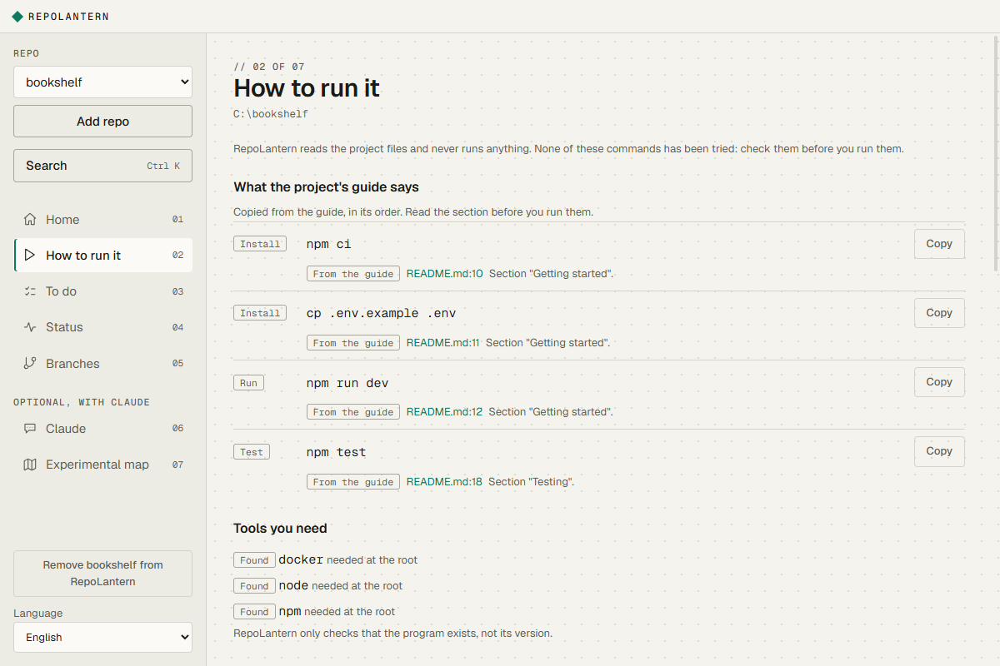
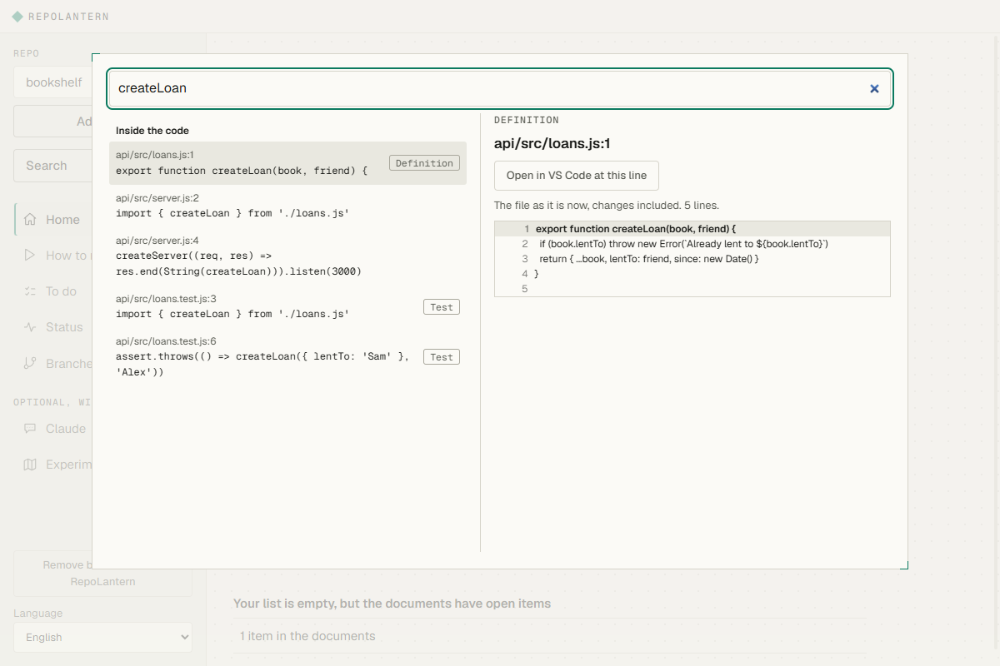
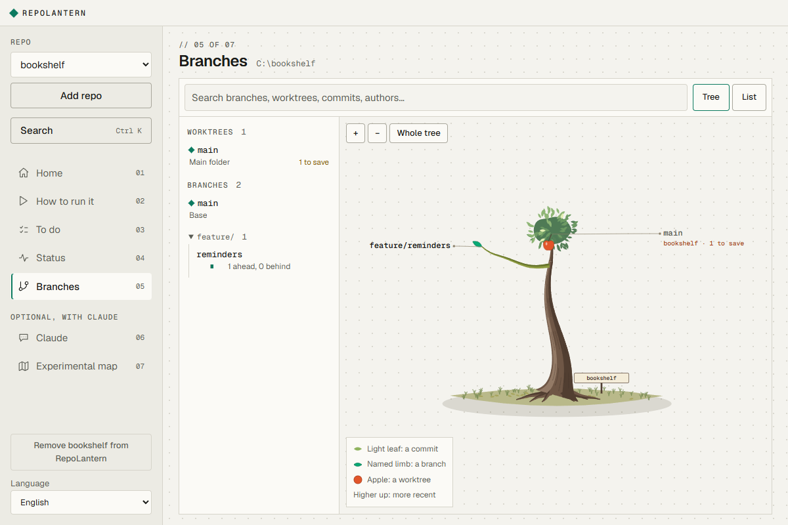

# RepoLantern

**Understand any codebase. Change it with confidence.**

RepoLantern is a Windows desktop app for the moment you open a project you did not write, or one an AI wrote for you, and have no idea where to start. It reads the repository and shows you how to run it, where things are and what state it is in.

It works without AI and without an account. It never runs anything from your project.

> Status: early. Windows only for now.



## What it does

- **How to run it.** Starts from what the project's own guide says, then finds the stack, the install, run, test and build commands, the tools you need and the environment variables to set, including in monorepos. Every command links to the file and line it came from, and says whether it comes from the guide, is written in the project, or is RepoLantern's guess.
- **Search inside the code.** `Ctrl+K` searches tracked and untracked files, puts real code before tests and docs, and opens the file at the right line. A phrase that isn't in the code falls back to files with those words, and the screen says so. It matches words, not meaning: "upload a photo" won't find code that only talks about assets. Secret files such as `.env` are skipped.
- **Home.** What changed recently and what is open.
- **Branch.** Branches, worktrees and commits as a tree you can walk through, with their diffs.
- **Review (experimental).** Checks your changes, a branch or the whole project for secrets and known risky patterns, without AI, and turns what you pick into to-dos. It never changes your code. Nothing found doesn't mean the code is safe.
- **To do.** A list per repository, plus the to-dos already written in your docs.

Optional, if you already have the [Claude Code](https://claude.com/product/claude-code) CLI installed and signed in:

- **Review with Claude (experimental).** Like a careful reviewer on your changes: a summary, then findings with severity, confidence, what they need to happen and how to fix them. It runs read-only on a clean copy, secrets are removed first, and every cited line is checked against the code. The reasoning is still a model's judgement, so this is not a security audit. It uses your Claude plan: in our few tests, a change to 4 files cost about $0.10 and one to 15 files about $1.20 and 10 minutes.
- **Claude.** A chat that runs through your own CLI. RepoLantern stores no keys and offers no login of its own.
- **Experimental map.** A generated overview of the code. It can be wrong, so treat it as a starting point and check it against the code.





## What it does not do

- It does not run your project's scripts, hooks or commands. RepoLantern shows commands; you decide whether to run them.
- It does not send your code anywhere. Only the optional Claude features talk to a model, through your CLI.
- It does not read the values in `.env` files. From example files such as `.env.example` it reads only the variable names.

## Install

[Download the Windows installer](https://github.com/Cxsee/RepoLantern/releases/latest). You need [Git](https://git-scm.com) installed. The installer is not code-signed yet, so Windows SmartScreen may warn you: choose "More info", then "Run anyway".

Or build it yourself, with [Node.js](https://nodejs.org) 24 or later and Git:

```bash
npm ci
npm run dev
```

`npm run dist` builds the Windows installer into `release/`.

## Development

```bash
npm run typecheck
npm test
npm run test:e2e
```

See [CONTRIBUTING.md](CONTRIBUTING.md). To report a vulnerability, see [SECURITY.md](SECURITY.md).

## License

[MIT](LICENSE). Third-party licenses, including the SIL Open Font License of the bundled fonts, are in [THIRD-PARTY-NOTICES.txt](THIRD-PARTY-NOTICES.txt).
